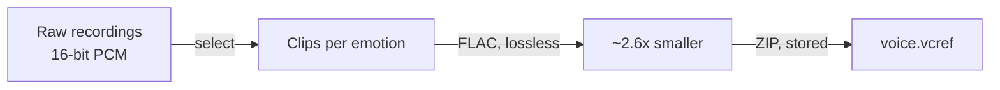
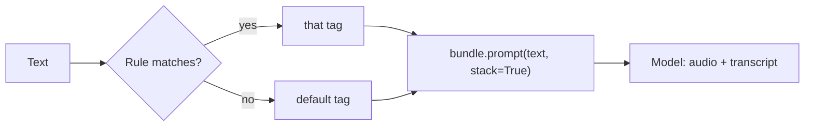

# vcref

A `.vcref` file is a portable **voice reference bundle** for zero-shot voice cloning: every reference clip of one
voice (one per intonation, for example), each with its transcript, plus default settings, regex rules that pick a clip
for a piece of text, and optional speaking-cadence measurements. One file, lossless FLAC inside, SHA-256 per clip.

This repo holds the format spec and two small libraries that read and write it:

| | Install | Docs |
|---|---|---|
| Python (no dependencies; `audio` extra decodes to arrays) | `pip install vcref` / `pip install "vcref[audio]"` | [python/README.md](python/README.md) |
| JavaScript (no dependencies; Node 18+ and browsers) | `npm install vcref` | [js/README.md](js/README.md) |
| The format | | [SPEC.md](SPEC.md) |
| Guides | | [compression](docs/compression.md), [extracting references](docs/extracting-references.md), [best practices](docs/best-practices.md) |

Both libraries pass the same tests against `fixtures/tiny.vcref`, produce the same bundle `id`, and read each other's files (checked in CI).

```python
import vcref
with vcref.Bundle("dean.vcref") as b:
    clip = b.clip(b.select_tag("Is this working?"))   # rules pick the clip, else the default
    print(clip.text, clip.sample_rate, len(clip.flac))  # FLAC bytes ready for your TTS prompt
```

```js
import { Bundle } from "vcref";
const b = await Bundle.open("dean.vcref");
const clip = await b.clip(b.selectTag("Is this working?"));
```

CLI in both: `vcref info|verify <file>` and `vcref unpack <file> <dir>`.

## Why it is small, and why that is safe

Zero-shot cloning does not need your whole recording session, only a few seconds of each way you speak. A `.vcref`
keeps those seconds, stores them as lossless FLAC, and indexes them in a ZIP so a reader opens only the clip it needs.



```
raw recordings   13.0 min   75.15 MB  ████████████████████████████████████████
kept clips       10.3 min   22.74 MB  ████████████▌   (79 clips, 24-bit FLAC, 48 kHz mono)   ~3.3x smaller
```

Nothing is lossy; each clip decodes to the samples that went in. Details, layout and caching: [docs/compression.md](docs/compression.md).

## Getting the right reference out

The clip you prompt a model with sets the delivery of what it says, so choosing it is the main quality lever.



```python
with vcref.Bundle("voice.vcref") as b:
    b.explain("Really?")                      # which rule fired, or that the default was used
    clips = b.prompt("Really?", stack=True)   # [question clip, neutral clip]
    b.search("podcast")                       # find clips by tag, label or transcript
    b.stats()                                 # sizes, bitrate, ratio vs raw PCM
```

Nine worked methods (rules, manual choice, stacking, handing a clip to VoxCPM or Qwen3-TTS, caching, cadence, in the
browser) are in [docs/extracting-references.md](docs/extracting-references.md). Recording, labelling and rule-writing
advice is in [docs/best-practices.md](docs/best-practices.md).

## Repo layout

```
SPEC.md          the format
python/          pip package (hatchling, src layout)
js/              npm package (ESM, no build step, .d.ts included)
fixtures/        tiny.vcref + tiny.id shared by both test suites; make_fixture.py regenerates them
.github/         CI (both test suites + cross-read) and tag-triggered releases to PyPI and npm
```

## Releasing

Tag `vX.Y.Z` after bumping `python/pyproject.toml`, `python/src/vcref/__init__.py` and `js/package.json`. The release
workflow publishes to PyPI (trusted publishing, no token stored) and npm (`NPM_TOKEN` secret, with provenance).
One-time setup: create the PyPI project with a trusted publisher pointing at this repo's `release.yml`, and add the npm token.

MIT licensed.
