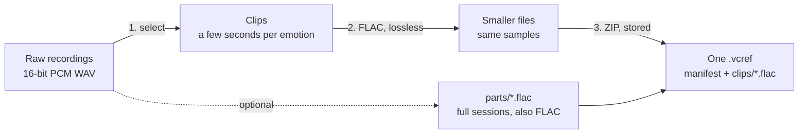
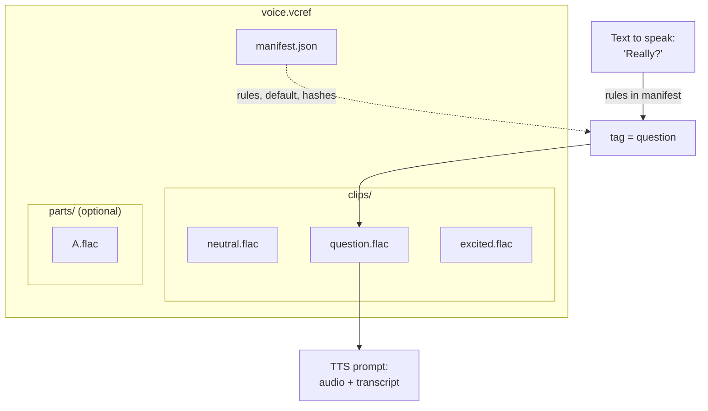

# How a .vcref stays small

A voice reference does not need your whole recording session. It needs a few seconds of each way you speak. A `.vcref`
keeps those seconds, stores them losslessly, and indexes them so a reader can pull out just one.

There is no lossy trick here. Nothing is re-encoded to a lower quality, and every clip decodes to the same samples the
recording had. The savings come from three ordinary steps.



## The three steps

**1. Select.** Enrollment cuts the recordings into labelled clips (neutral, question, excited, whisper and so on) and
keeps only the clips a model will actually be prompted with. Pauses, retakes and filler between them are dropped.

**2. FLAC.** FLAC is lossless compression for audio: it predicts each sample from the ones before it and stores only
the prediction error. Speech is highly predictable, so it typically shrinks to well under half of raw PCM. Clips are
stored as 24-bit FLAC, which keeps more headroom than the 16-bit source for later processing.

**3. ZIP, stored.** The container is a ZIP written with method 0 (no second compression pass). FLAC is already
compressed, so deflating it again costs time and saves nothing. ZIP also gives random access: the central directory
lists every entry with its offset, so a reader jumps straight to one clip.

## Measured example

One enrollment of a real voice (48 kHz mono):

```
raw recordings   13.0 min  16-bit PCM   768 kbps   75.15 MB  ████████████████████████████████████████
kept clips       10.3 min  24-bit FLAC  ~295 kbps   22.74 MB  ████████████▌
                                                              79 clips, average 0.29 MB each
```

That is about **3.3x smaller**, of which roughly 1.26x comes from selecting only the useful audio and roughly 2.6x
from FLAC. If you also embed the full sessions as `parts/`, the file grows by about 26.6 MB (49.4 MB total), still
smaller than the raw recordings and fully verifiable.

Run `vcref.Bundle(path).stats()` (Python) or `bundle.stats()` (JavaScript) on your own file to get the same numbers.

## Layout inside the file

```
voice.vcref  (a ZIP, archive comment "VCREF1")
├── manifest.json        names, default clip, rules, config, cadence, per-file SHA-256
├── clips/
│   ├── neutral.flac     ~0.3 MB each
│   ├── question.flac
│   ├── excited.flac
│   └── ...
└── parts/               optional full recordings
    ├── A.flac
    └── B.flac
```



Only the clip that matches the text is read and decoded. The rest of the file is never touched, which is why a large
bundle costs no more to use than a small one.

## Integrity and caching

Every clip and part has a SHA-256 in the manifest, and `verify()` recomputes them. The bundle `id` is the first 12 hex
characters of the hash of the sorted clip hashes, so it identifies the audio only: renaming the voice or changing
`config` keeps the same `id`, while changing any clip changes it. Use it as a cache key for decoded audio or for
generated speech.
