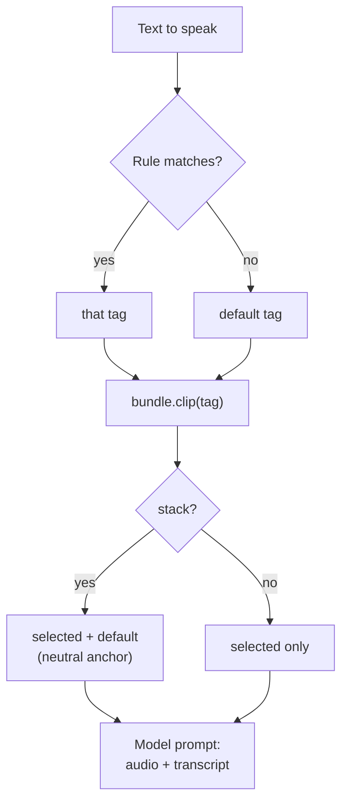

# Pulling the right reference out of a .vcref

A zero-shot model copies the voice, and also the delivery, of the clip you prompt it with. A question prompted with a
flat clip comes out flat. So picking the clip is the main quality lever, and a `.vcref` gives you several ways to do it.



All examples are Python. The JavaScript API has the same methods in camelCase (`selectTag`, `explain`, `prompt`,
`search`, `stats`), and the clip and prompt calls are `async` there.

## 1. Let the rules choose

The manifest holds ordered regular-expression rules. The first match wins, otherwise the default clip is used.

```python
import vcref

with vcref.Bundle("voice.vcref") as b:
    tag = b.select_tag("Is this working?")     # "question" if a rule matches a trailing "?"
    clip = b.clip(tag)
    print(clip.tag, clip.text, clip.seconds, clip.sample_rate)
```

Writing rules when you build a bundle (patterns use the portable subset of `re` and `RegExp`):

```python
rules = [
    {"pattern": r"\?\s*$", "tag": "question"},
    {"pattern": r"!\s*$", "tag": "excited"},
    {"pattern": r"^(whisper|psst)\b", "tag": "whisper"},
]
vcref.pack("voice.vcref", clips, rules=rules)
```

## 2. Find out why a clip was chosen

When a line sounds wrong, `explain` shows which rule fired, or that none did.

```python
b.explain("Really?")
# {'tag': 'question', 'why': 'rule', 'rule': 0, 'pattern': '\\?\\s*$'}
b.explain("Plain.")
# {'tag': 'neutral', 'why': 'default', 'rule': None, 'pattern': None}
```

## 3. Choose by hand

Skip the rules when you know what you want. `tags` lists what the bundle holds, `search` finds clips by tag, label or
transcript text, and `clip(tag)` reads one.

```python
b.tags                      # ['neutral', 'question', 'excited', 'whisper', ...]
b.search("podcast")         # ['podcast_intro', 'podcast_outro']
b.clip("whisper")           # unknown tags fall back to the default clip
```

## 4. Stack a neutral anchor

Emotional clips pull the voice toward that emotion. Adding the default clip as a second reference keeps the timbre
steady across them. `prompt` returns the selected clip first, then the default when it differs.

```python
for c in b.prompt("You did what?!", stack=True):
    print(c.tag, c.seconds)         # excited 6.1, then neutral 11.4
```

How a given engine uses more than one reference is up to the engine. Engines that take one prompt clip use the first.

## 5. Hand the clip to a model

`Clip.flac` is the FLAC bytes, `Clip.text` the transcript. Most engines want a file path or an array.

```python
import tempfile, pathlib

# VoxCPM: prompt-continuation cloning (reference audio + its transcript)
clip = b.prompt(text)[0]
wav_path = pathlib.Path(tempfile.mkdtemp()) / f"{clip.tag}.flac"
wav_path.write_bytes(clip.flac)
audio = voxcpm_model.generate(text=text, prompt_wav_path=str(wav_path), prompt_text=clip.text)

# Qwen3-TTS: build the clone prompt once, reuse it for every line
prompt = qwen_model.create_voice_clone_prompt(ref_audio=str(wav_path), ref_text=clip.text, x_vector_only_mode=False)
```

The transcript has to match what is said in the clip. A wrong transcript is the most common reason for a clone that
drifts or repeats words.

## 6. Cache by id

Decoding is cheap but not free, and synthesis is expensive. Key both on the bundle `id` and the tag.

```python
cache_key = (b.id, tag, text)           # same audio content -> same key, even if the file was renamed
```

## 7. Check before you trust

```python
b.verify()                      # raises VcrefError on a bad hash or missing entry
s = b.stats()
s["clips"], s["clip_seconds"], s["kbps"], s["pcm16_ratio"]
sorted(s["per_clip"], key=lambda p: p["seconds"])[:3]     # the shortest clips, often the weakest references
```

As a rule of thumb (not a guarantee), very short clips of a few seconds tend to give a thin, unstable clone, and very
long ones add cost without much gain. Judge by ear for your engine.

## 8. Pace like the speaker

If the bundle carries `cadence` (measured speaking rate, pause lengths, pitch range), you can steer a model toward the
speaker's own rhythm.

```python
g = b.cadence["global"]
g["rate"], g["pauses"]["comma"]["med"]      # syllables per second, typical comma pause in seconds
t = b.cadence["tags"].get("question")       # per-clip-type stats, when present
```

Every `cadence` member is optional, so read with `.get`.

## 9. In the browser

Nothing needs Node or a server. Fetch the file, hand it to the JavaScript library, and decode the FLAC with the audio
stack the browser already has.

```js
import { Bundle } from "vcref";

const b = await Bundle.fromBytes(await (await fetch("voice.vcref")).arrayBuffer());
const [clip] = await b.prompt("Really?");
const ctx = new AudioContext();
const buffer = await ctx.decodeAudioData(clip.flac.buffer.slice(clip.flac.byteOffset, clip.flac.byteOffset + clip.flac.byteLength));
```
